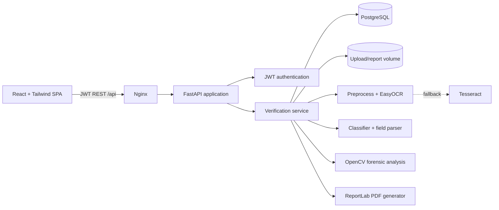

# System architecture

## Verification lifecycle

1. The upload endpoint validates extension, MIME type, magic bytes, and size before writing an unpredictable filename.
2. OCR preprocessing denoises, locally enhances contrast, estimates/repairs modest skew, then calls EasyOCR. Tesseract handles an unavailable EasyOCR model.
3. The parser identifies document type from identifier/keyword patterns and extracts normalized fields. Set `ENABLE_TRANSFORMERS=true` to allow the Hugging Face zero-shot classifier for ambiguous scans and FLAN-T5-based neutral findings explanations. Both have deterministic fallbacks if a model cannot be loaded.
4. Forensics combines OCR confidence variation, Laplacian blur, local JPEG recompression differences, and ORB repeated-feature patterns. These are review indicators, not proof of fraud.
5. Risk and confidence are persisted with an immutable-style audit event. Suspicious results enter a human review queue, where a reviewer records an approve/reject/request-information decision and rationale. The report generator emits a downloadable PDF.

## Production notes

- Replace `SECRET_KEY`; terminate HTTPS in front of Nginx; use a managed PostgreSQL instance and encrypted object storage for uploads/reports.
- Run database migrations instead of `create_all` before a multi-instance rollout. Add a worker queue when OCR volume grows, so `POST /verify` can be asynchronous.
- Restrict CORS to known front-end origins, provide deletion/retention controls, scan uploads for malware, and require an issuer-side lookup for any high-stakes decision.
